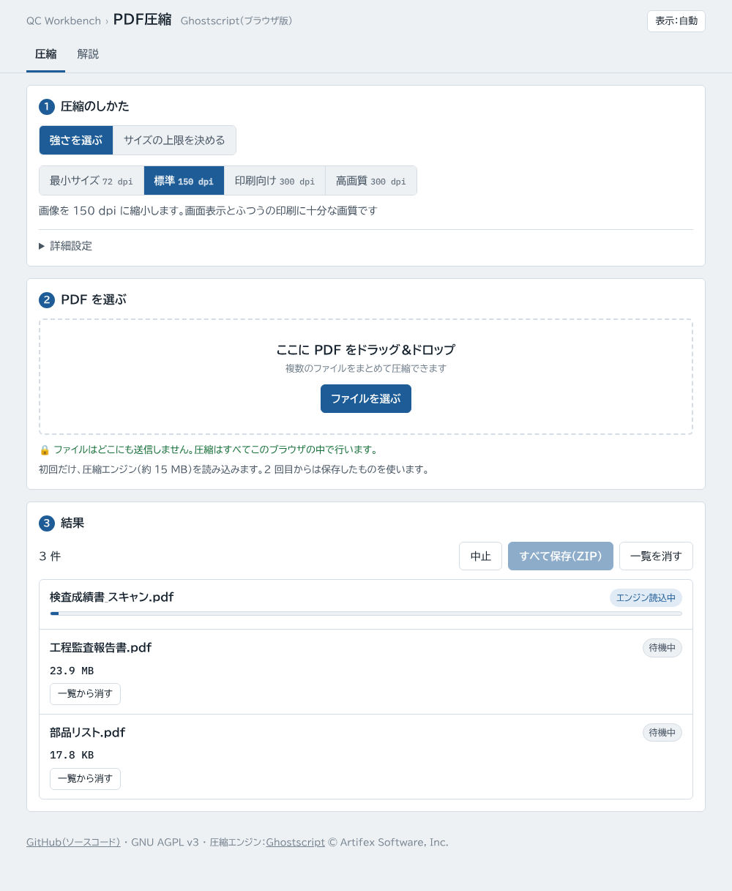
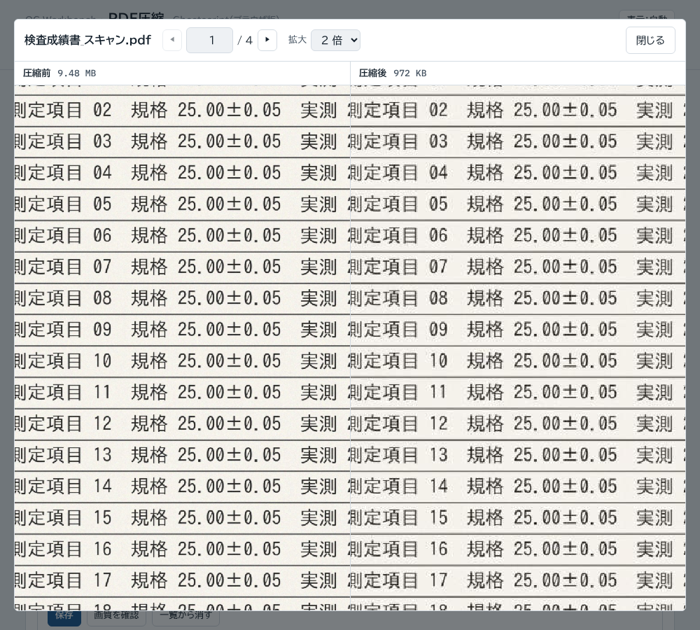

# PDF圧縮（PDFComp）

PDF のファイルサイズを小さくする Web ツールです。スキャンした書類や写真の多い報告書を、メールやシステムに添付できる大きさまで縮めます。

**https://kotaooka.github.io/PDFComp/**

インストールは不要で、ブラウザで開くだけで使えます。

- **ファイルは外に出ません**。圧縮はブラウザの中の Ghostscript で行い、どこにも送信しません
- 複数のファイルをまとめて圧縮し、ZIP でまとめて保存できます
- 一度開けば**オフラインでも動きます**。PC やスマートフォンにアプリとして追加することもできます

---

## 使い方

1. 圧縮の強さを選びます（迷ったら「標準」）
2. PDF をドラッグ＆ドロップするか「ファイルを選ぶ」で選ぶと、すぐに圧縮が始まります
3. 「保存」で 1 件ずつ、「すべて保存（ZIP）」でまとめて保存します。ファイル名は `元の名前_compressed.pdf` です

初回だけ、圧縮エンジン（約 15 MB）を読み込みます。2 回目からはブラウザに保存したものを使います。

### 圧縮の強さ

| 強さ | カラー・グレー画像 | 向いている用途 |
|---|---|---|
| 最小サイズ | 72 dpi | 画面で見るだけ、容量制限が厳しいとき |
| 標準 | 150 dpi | ほとんどの資料。画面表示とふつうの印刷 |
| 印刷向け | 300 dpi | 印刷して使う資料 |
| 高画質 | 300 dpi | 色を正確に残したいとき（カラープロファイルを保持） |

「詳細設定」で、画像の解像度を直接指定したり、白黒（グレースケール）にしたりできます。

### 画質を確かめる

「画質を確認」で、圧縮前と圧縮後の同じページを並べて表示します。2 つの表示は一緒にスクロールし、2 倍・3 倍に拡大できます。

## 圧縮で変わること

- **残るもの**：ページの見た目、しおり（ブックマーク）、リンク、文書のタイトル・作成者
- **入力欄（フォーム）**：入力済みの値のまま、書き込めない文字になります
- **電子署名**：無効になります。署名済みの書類は、提出用には元のファイルを使ってください
- **パスワード**：開くのにパスワードが要る PDF は、入力すると圧縮できます。圧縮後のファイルにはパスワードがかかりません
- 文字と線だけの PDF はもともと小さく、あまり縮みません。かえって大きくなった場合は、圧縮結果を使わないよう表示します

詳しくは画面の「解説」タブを見てください。

## 動作環境

Chrome・Edge・Firefox・Safari の最新版。扱える大きさはブラウザのメモリに左右され、数百 MB を超える PDF は失敗することがあります。

Chrome・Edge でアプリとして追加すると、エクスプローラーで PDF を右クリック →「プログラムから開く」でこのツールに渡せます。

## 以前のバッチ版

Ghostscript をインストールして使う Windows 用のバッチファイルは [legacy/PDFComp.bat](legacy/PDFComp.bat) に残しています。

## ライセンス

[GNU AGPL v3](LICENSE)。圧縮エンジンの Ghostscript（Artifex Software, Inc.）が AGPL v3 のため、このツールも AGPL v3 で公開しています。同梱の WebAssembly 版は [okathira/ghostpdl-wasm](https://github.com/okathira/ghostpdl-wasm)、Ghostscript のソースは [ArtifexSoftware/ghostpdl](https://github.com/ArtifexSoftware/ghostpdl) にあります。

開発者向けの情報は [DEVELOPMENT.md](DEVELOPMENT.md) にあります。
